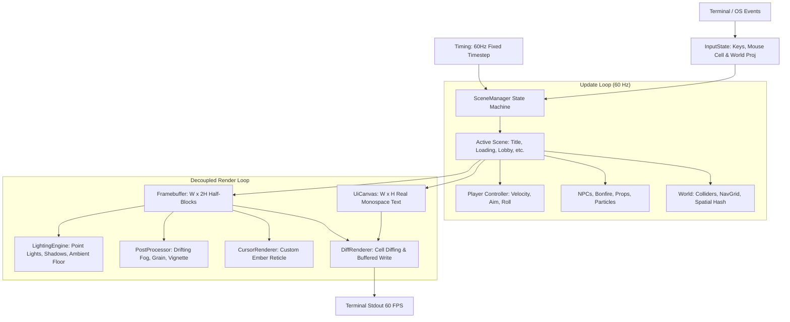

# Atrocitus Architecture & Technical Design

## 1. High-Level Overview

**Atrocitus** is a terminal-based, dark-fantasy, souls-like 2.5D action RPG built in Rust. It runs in truecolor terminals (24-bit ANSI color) at a minimum resolution of 120 columns × 40 rows.

The engine uses a **hybrid dual-layer rendering architecture**:
1. **Half-Block Graphics Layer (`Framebuffer`)**: Operates at $W \times 2H$ logical pixel resolution utilizing the Unicode half-block character (`▀`, `fg` = top pixel, `bg` = bottom pixel) for 2.5D pixel art, sprite compositing, dynamic point lights, soft ground shadows, and atmospheric post-processing.
2. **Real-Character UI Layer (`UiCanvas`)**: Operates at $W \times H$ terminal cells rendering crisp 1-cell monospace ANSI characters with box-drawing borders (`─ │ ┌ ┐ └ ┘`), `unicode-width` word-wrapping, padding, and 2-cell screen anchoring.
3. **Differential Output (`DiffRenderer`)**: Batches cell changes between frames, minimizing stdout writes and eliminating terminal flicker at 60 FPS.



---

## 2. Directory Structure & Module Responsibilities

```
src/
├── main.rs                 # Engine lifecycle, TrueColor check, event loop, panic hook
├── assets/                 # Asset management, procedural sprites, palette
│   ├── mod.rs
│   ├── font_data.rs        # 3x5 and 5x7 bitmap font glyph tables
│   ├── palette.rs          # Curated dark-fantasy 24-bit color palette
│   └── sprites.rs          # Procedural sprite generator, PNG loader, LayeredGear
├── engine/                 # Core engine primitives (graphics, input, timing)
│   ├── mod.rs
│   ├── color.rs            # RGBA color math, alpha blending, ANSI escape formatting
│   ├── cursor.rs           # In-game custom reticle & hover tooltips
│   ├── framebuffer.rs      # 2D logical pixel grid, half-block primitives, draw_ellipse
│   ├── input.rs            # Kitty keyboard enhancement, held timeouts, mouse tracking
│   ├── lighting.rs         # 2.5D radial point lights, soft shadows, ambient lighting floor
│   ├── pathfinding.rs      # Grid A* pathfinding & obstacle navigation
│   ├── postprocess.rs      # Atmospheric fullscreen passes (fog, film grain, vignette)
│   ├── renderer.rs         # Diff-based terminal renderer combining Framebuffer + UiCanvas
│   ├── terminal.rs         # RAII TerminalGuard (raw mode, alternate screen, mouse capture, panic hook)
│   ├── text.rs             # Bitmap pixel font rasterizers (Tiny 3x5, Normal 5x7)
│   └── timing.rs           # 60 Hz fixed timestep accumulator, FPS counter
├── game/                   # Gameplay entities, world state, systems
│   ├── mod.rs
│   ├── bonfire.rs          # Interactive bonfire, coiled sword, flame particles, rest logic
│   ├── camera.rs           # Smooth 2.5D follow camera with boundary clamping
│   ├── classes.rs          # Class definitions, attributes, RON save data persistence
│   ├── equipment.rs        # Layered equipment compositing for character sprites
│   ├── inventory.rs        # 5x4 grid inventory, item rarities, tooltips, debug generator
│   ├── map.rs              # Fog-of-war MapGrid with circular revelation
│   ├── npc.rs              # Colosseum NPCs (Firekeeper, Blacksmith, Adventurer, Witch)
│   ├── particles.rs        # Zero-allocation particle pool (ash, embers, dust, sparks)
│   ├── player.rs           # Player entity: acceleration, wall-sliding, mouse aim, roll
│   └── world.rs            # Ashen Colosseum arena, colliders, parallax sky, props
├── scenes/                 # Scene state machine and overlays
│   ├── mod.rs              # Scene trait, SceneManager, fade transitions
│   ├── adventurer_dialogue.rs # Unknown Adventurer dialogue overlay
│   ├── backpack.rs         # Fullscreen 5x4 inventory overlay
│   ├── blacksmith.rs       # Blacksmith forge & upgrade station overlay
│   ├── class_select.rs     # 5-card mantle selection screen
│   ├── dialogue.rs         # Cinematic letterbox Firekeeper dialogue
│   ├── gallery.rs          # Fullscreen 1x and 3x sprite gallery viewer
│   ├── loading.rs          # Staged asset generator & lore tips
│   ├── lobby.rs            # The Ashen Colosseum hub scene
│   ├── map.rs              # Fullscreen arena map with fog-of-war
│   ├── spellbook.rs        # Grimoire spellbook overlay
│   ├── title.rs            # Title screen with parallax spires & logo glow
│   └── witch_shop.rs       # Shady Witch arcane shop overlay
└── ui/                     # Monospace terminal UI layout & rendering
    ├── mod.rs
    ├── canvas.rs           # UiCanvas, UiCell, border styles, debug rect overlays
    └── layout.rs           # Rect, Margin, Padding, word_wrap, text_width, truncation
```

---

## 3. Core Data Flow & Subsystems

### 3.1 Input Subsystem (`engine/input.rs`)
- Polls Crossterm `Event::Key` and `Event::Mouse`.
- Maps keyboard events to `VirtualKey` (WASD, Arrows, Space, Shift, E, M, B, K, F1..F9, Esc).
- Fallback held-key tracking for terminals without release event reporting (500ms initial press timeout, 150ms repeat timeout).
- Converts terminal cell coordinates to sub-cell logical pixels:
  $$x_{\text{screen}} = \text{col}, \quad y_{\text{screen}} = \text{row} \times 2.0 + 0.5$$
- Unprojects screen coordinates to world ground plane coordinates:
  $$x_{\text{world}} = \text{cam}_x + x_{\text{screen}}, \quad y_{\text{world}} = \text{cam}_y + y_{\text{screen}}$$

### 3.2 Main Game Loop (`main.rs`)
- Fixed timestep: $dt = \frac{1}{60} \approx 0.01667\,\text{s}$.
- Accumulator pattern with decoupled rendering.
- `scene_mgr.update(dt, &input, &sprite_bank)` executes in fixed steps.
- `scene_mgr.render(&mut framebuffer, &mut ui, &sprite_bank)` executes once per frame.
- Frame rate capped to 60 FPS using `std::thread::sleep`.

### 3.3 Scene Management (`scenes/mod.rs`)
- Implements `Scene` trait: `update(dt, input, bank) -> SceneTransition`, `render(fb, ui, bank)`, `on_resize(w, h)`.
- `SceneTransition`:
  - `None`: Keep current scene.
  - `Switch(Box<dyn Scene>)`: Cross-fade to new scene via `FadeState`.
  - `Push(Box<dyn Scene>)`: Push modal overlay (e.g., Map, Backpack, Dialogue) on top of the stack.
  - `Pop`: Close current overlay.
  - `Quit`: Terminate application cleanly.
- When stacked (`scenes.len() > 1`), underlying scene is rendered first, allowing transparent overlays.

### 3.4 Dual-Layer Differential Rendering (`engine/renderer.rs`)
- `Framebuffer`: $W \times 2H$ vector of `Color` (RGB/RGBA).
- `UiCanvas`: $W \times H$ vector of `Option<UiCell>` (`UiCell` contains `ch`, `fg`, `bg`, `bold`, `dim`).
- Each terminal cell $(c, r)$ corresponds to:
  - Framebuffer top pixel: $(c, r \times 2)$
  - Framebuffer bottom pixel: $(c, r \times 2 + 1)$
- If `UiCell` is present:
  - If background is opaque, uses cell `bg`.
  - If background is `None`, blends glyph over framebuffer average color.
- If `UiCell` is absent:
  - Emits half-block `'▀'` with `fg` = top pixel color, `bg` = bottom pixel color.
- Output diffing: Compares against `prev_cells` buffer and only emits ANSI escape codes for modified cells.

---

## 4. Key Structs & Contracts

| Struct | Module | Role |
|---|---|---|
| `TerminalGuard` | `engine::terminal` | RAII guard enabling raw mode, alternate screen, mouse capture; restores terminal on drop AND panic. |
| `DiffRenderer` | `engine::renderer` | Differential cell renderer with 128KB stdout write buffering. |
| `Framebuffer` | `engine::framebuffer` | 2D pixel buffer with half-block, circle, ellipse, line, and blend operations. |
| `UiCanvas` | `ui::canvas` | Monospace character grid with box borders and centered title bars. |
| `Rect` | `ui::layout` | `i32`-based bounding rectangle for layout anchoring and clipping. |
| `Player` | `game::player` | Velocity-based movement, continuous mouse facing hysteresis, eased dodge roll state machine. |
| `World` | `game::world` | Elliptical arena ground plane, perimeter colliders, props, and parallax sky. |
| `Npc` | `game::npc` | Colosseum NPCs with animations, contact shadows, overhead glyphs, and proximity prompts. |
| `LightingEngine` | `engine::lighting` | Ambient floor ($\ge 35\%$), radial point lights with harmonic flicker, and soft ground shadows. |
| `MapGrid` | `game::map` | Fog-of-war grid with coordinate projection and circular clearing. |
| `Inventory` | `game::inventory` | 5x4 slot item inventory with rarity tiers and stacking. |

